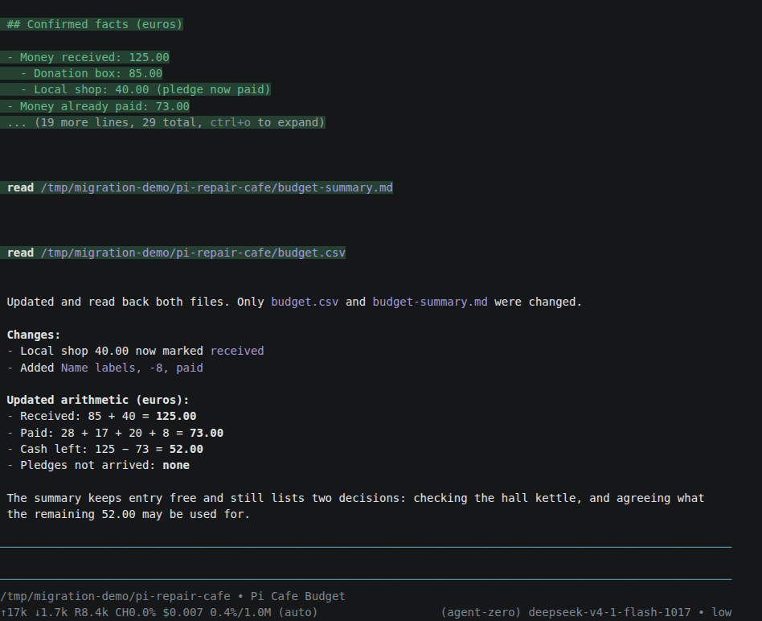
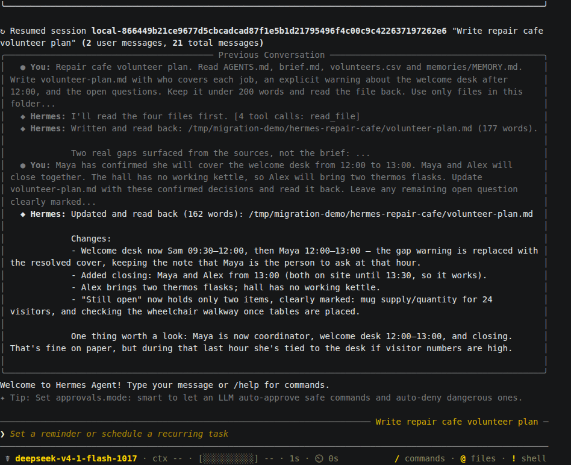
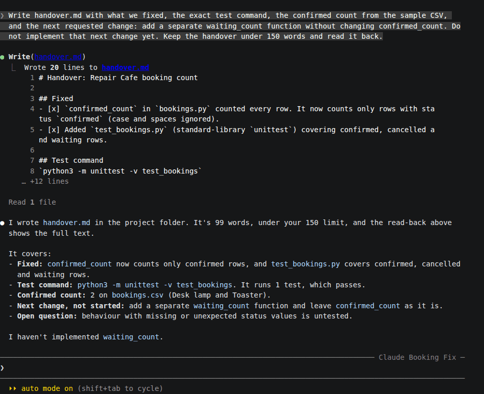
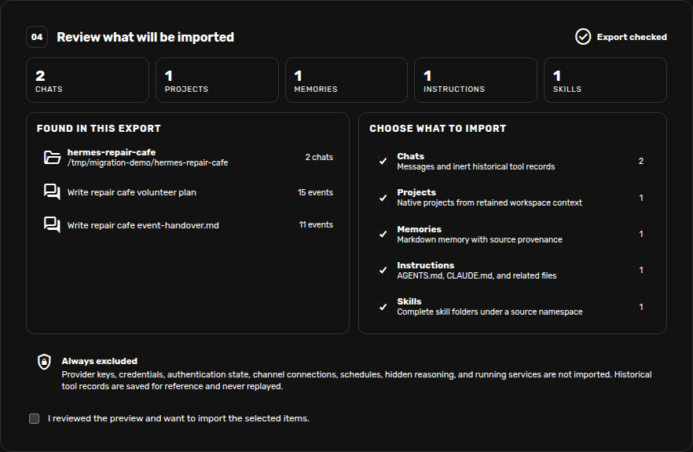
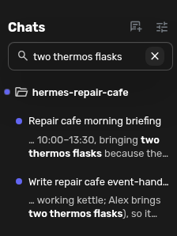
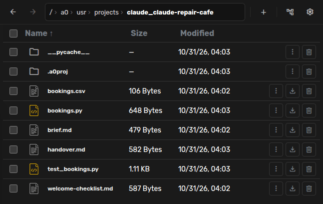
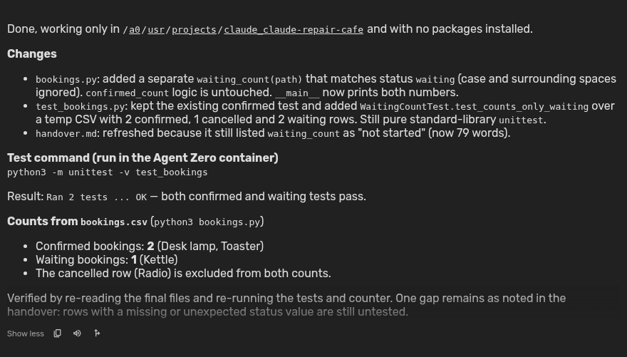

# Move your chats into Agent Zero

Bring over a conversation you have already started, check the result, and carry
on in Agent Zero. **Migrate Agents** can also bring over project groupings,
notes, instructions, and skills. Your original files stay where they are.

This guide follows a repair cafe project through **Pi**, **Hermes Agent**, and
**Claude Code**. Each app has two real chats. The examples include a revised
budget, a volunteer handover, and a small booking-counter fix.

Choose your starting point: [Pi](#pi), [Hermes Agent](#hermes-agent), or
[Claude Code](#claude-code). OpenClaw, OpenCode, and Codex are also supported;
their export instructions appear when you select them in the plugin.

Pi import and saved Claude chat names are recent additions. Older releases may
not include them. If Pi is not listed, your version does not include its importer yet.

## Before you start

- Finish or pause work in the source app before making your export.
- Keep a copy of the original conversations and project files, and
  [back up Agent Zero](usage.md#backup-and-restore) before a large import.
- Start with one project or a few chats. Do not upload your entire home folder.
- Check the files for private information before importing or sharing them.

Conversation files can contain text read from files and command output,
including private details or secrets. Review those too, especially when using
raw Pi or Claude Code session files.

The import copies conversations. It does **not** copy the working files
mentioned inside them. You will bring those files over separately after import.

## Pi

Pi normally saves conversations as `.jsonl` files under:

```text
~/.pi/agent/sessions/
```

Open the folder for your project and choose the sessions you want. Folder names
are based on the workspace path, and filenames include a timestamp. If you are
unsure which file to choose, open it in a text editor and check its first user
message. A custom session directory works too.

Use these original session files. Pi's HTML export is for reading in a browser
and cannot be used for this import. Add your project's `AGENTS.md` and any
complete skill folders separately if you want to keep those too.



Our budget chat first kept a promised donation separate from money received.
In a follow-up, the donation arrived and we bought name labels. Pi updated the
files and calculated **52 euros left**. A second chat drafted a thank-you note.
Both belong to the same project after import.

If a Pi session has several retained branches, each branch becomes a separate
chat. Their shared earlier messages appear in each copy. Branches from one
session file are imported together; the preview cannot select them individually.

## Hermes Agent

List your saved sessions and copy the IDs of the conversations you want:

```bash
hermes sessions list
```

To narrow the list to one project, use its folder name:

```bash
hermes sessions list --workspace repair-cafe
```

Export each chat to a different file. Replace the example IDs with your own:

```bash
hermes sessions export volunteer-plan.jsonl --session-id FIRST_SESSION_ID --redact
hermes sessions export event-handover.jsonl --session-id SECOND_SESSION_ID --redact
```

Select both files in one import. Using different filenames avoids replacing
your first export with the second. `--redact` removes recognized secrets; still
review the result before sharing it.

You can also select notes from `~/.hermes/memories/`, wanted instruction files,
and complete folders from `~/.hermes/skills/`. If you keep them in a project or
a different Hermes data directory, choose them from there instead.



Our first chat found a gap at the welcome desk after noon. A follow-up assigned
Maya to cover it and recorded that Alex would bring thermos flasks. The second
chat used an event-handover skill to prepare a short handover. We included that
skill and a note about reusable mugs and wheelchair access in the import.

## Claude Code

Claude Code keeps project conversations under:

```text
~/.claude/projects/
```

Find the folder for your workspace and select its conversation `.jsonl` files.
The folder name is based on the full workspace path and may look different
from the short project name. Check a file's first user message if needed.

Add the project's `CLAUDE.md`, any memory documents you want to keep, and
complete skill folders separately. Select only the project data you need,
not the whole `~/.claude/` folder with its sign-in and settings files. Subagent
conversations are omitted. Named chats keep their saved names when imported;
Agent Zero's normal chat naming can update a name as you continue working.



Our booking counter was counting cancelled and waiting entries. Claude Code
fixed it, ran a test, and confirmed that **two bookings** were confirmed. We
then asked for a handover with one unfinished task: add a separate count for
waiting bookings. A second chat prepared a welcome-desk checklist.

## Review and import

1. In Agent Zero, open **Plugins**, select **Builtin**, and find **Migrate Agents**.
2. Enable it if needed, click **Open**, and select the source app.
3. Use **Choose files** or **Choose folder** to select just the project data you
   prepared. ZIP, TAR, and TAR.GZ archives work too.
4. Click **Review selected data**. Check the names, project paths, counts, and warnings.
5. Uncheck any categories you do not want. To leave out a particular chat,
   remove its source file from the selection and review again. For Pi, this
   also leaves out the other branches stored in that file.
6. Check **I reviewed the preview and want to import the selected items**, then
   click **Import selected data**.



The preview does not create chats or change files. Import opens the first chat;
the others are available in the sidebar. When **Projects** is selected, chats
with the same saved workspace path are grouped into a project. The folder you
upload from does not determine the grouping.

Importing the same export again creates another copy. If an import reports an
error, check what was created before trying again. Remove only unwanted copies
after checking them; do not delete a project that contains work you still need.

## Find and check your imported chats

Use **Search** under **Chats** to look for a title or a phrase from a message.
Matching message excerpts appear beneath the chat name. Click a result to open
the conversation. Existing project and activity filters still apply.



Check a follow-up decision as well as the first message. In our example, the
updated noon cover matters more than the first draft of the volunteer plan.
Earlier file reads, edits, and commands appear as history. Import does not run
them again.

Clear the search with its close button or Escape. If the field is hidden, open
**Sidebar view options**, then choose **Search → Standard**. Search covers the
current chat list, not deleted or archived chats.

## Bring over your working files

Open the imported project's folder menu and choose **Project files**, or open
**Files** and navigate to that project's folder under `/a0/usr/projects/`.
Use **Upload Files** to copy the documents, data, or code the conversation needs.
Leave Agent Zero's `.a0proj` folder alone.



For example, the booking chat remembers that `bookings.py` was edited. That
does not mean the file exists in Agent Zero. We uploaded the script, its CSV,
the test, and the handover before asking Agent Zero to continue.

Tell Agent Zero where the files are now. Old paths in the conversation still
describe the source computer and may not work in the new project.

## Pick up where you left off

Open the imported chat and give it one concrete next step. For the booking
example, we used:

> The project files are now in this Agent Zero project folder. Read the handover,
> add the waiting-count function we discussed, and run the existing tests.

Agent Zero added the waiting-count function and its test. Both tests passed,
and the original CSV still gave **two confirmed bookings and one waiting**.



The other chats continued too. Agent Zero used Pi's revised budget to calculate
**37 euros** after a proposed 15-euro reserve. It used the Hermes handover,
imported note, and skill to write a morning briefing with Maya covering noon
and Alex bringing the thermos flasks.

You can do the same with an unfinished document or plan. Ask for a small change,
check the saved result, and then continue with the rest of your work. Agent Zero
uses its own model and tool settings; the source app's provider setup is not
transferred.

## Notes, instructions, and skills

| What you select | What you get |
| --- | --- |
| Chats | Conversations you can open and continue in Agent Zero. |
| Projects | A project grouping for chats with a saved workspace path. Working files still need copying. |
| Memories and instructions | Saved documents under `/a0/usr/knowledge/_migrate_agents/`, organized by source and category. |
| Skills | Separate skill copies under `/a0/usr/skills/_migrate_agents/`. |

Imported instruction documents do not automatically become project rules.
Review them, then copy the parts you want into the project's instructions or
an approved `AGENTS.md`. Review imported skills before using them too.

Provider keys, sign-in files, settings, schedules, and connected services are
not transferred. Image contents and other attachments may be missing even when
their names appear in a message; copy the actual files you need.

If the preview reports skipped records or size limits, use a smaller export and
check the affected conversation. For supported formats, branch details, and
exact limits, see the [Migrate Agents reference](../../plugins/_migrate_agents/README.md).

## Related guides

- [Projects](projects.md)
- [Memory](memory.md)
- [Skills](skills.md)
- [Backup and restore](usage.md#backup-and-restore)
